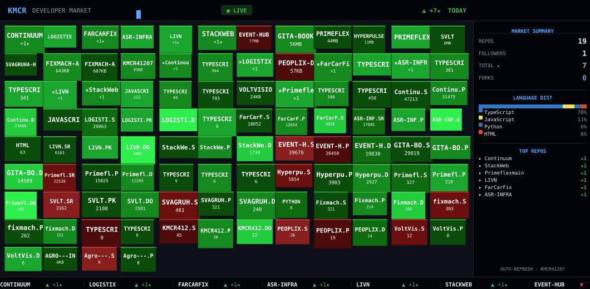

# K Mani Charan Reddy

**Full-Stack Developer · UI/UX Designer · Builder**

*Building thoughtful digital experiences, from AI-powered tools to logistics platforms.*

<!-- Generated by scripts/generate_terminal.py; automatically refreshed by GitHub Actions. -->

## About me

Growing up around logistics operations—tractors, harvesters, and transportation systems—I developed an early fascination with how complex real-world problems get solved through coordination and smart systems. Photography and videography taught me to see composition, tell stories, and appreciate design that works.

My first B.Tech hackathon changed everything. I discovered that ideas could become actual, functioning products—that code wasn't just theory. Since then, I've been combining software engineering with UI/UX design to build platforms for logistics, e-commerce, automotive assistance, and business solutions.

I lead hackathon teams, enjoy explaining technical concepts, and take projects from initial sketches to deployed applications. Outside development, you'll find me exploring cars, motorcycles, and motorsports—where precision engineering meets pure speed.

Currently pursuing **B.Tech in Computer Science Engineering at MLR Institute of Technology (2029)**, based in **Hyderabad, India**.

 

## ⚡ Tech Stack

### Frontend Development

### Backend & Databases

### Design & Creative Tools

### Development Tools

 

## 🚀 Featured Projects

<table>
<tr>
<td width="50%" valign="top">

### 01 · FarCarFix
#### AI-Powered Automotive Diagnostics

AI-assisted vehicle diagnostics platform with image-based issue detection, repair guidance, cost estimation, and mechanic discovery services.

**Tech Stack:**

</td>
<td width="50%" valign="top">

### 02 · FleetFlow
#### Digital Freight Logistics Platform

Comprehensive fleet and logistics management system connecting shippers, drivers, fleet owners, and administrators on a unified platform.

**Tech Stack:**

</td>
</tr>

<tr>
<td width="50%" valign="top">

### 03 · Livaani
#### Ethnic Fashion E-Commerce

Modern Indian ethnic fashion e-commerce platform featuring product discovery, customization, authentication, and order management systems.

**Tech Stack:**

</td>
<td width="50%" valign="top">

### 04 · Stackweb
#### Web Development Studio

Professional web development and design startup delivering responsive business websites, e-commerce solutions, and custom web applications.

**Tech Stack:**

</td>
</tr>

<tr>
<td width="50%" valign="top">

### 05 · ASR Infra
#### Logistics & Infrastructure Services

Integrated logistics, transportation, and construction-material services platform streamlining infrastructure operations and supply chain management.

**Tech Stack:**

</td>
<td width="50%" valign="top">

</td>
</tr>

</table>

 

## Developer market heatmap

<!-- Generated by scripts/generate_heatmap.py — refreshed daily by GitHub Actions -->
<!-- Tiles = repositories · Size = activity weight · Green = high stars/forks · Red = low activity -->

## Contribution snake

  

[Explore my repositories](https://github.com/KMCR41207?tab=repositories) · [Follow on GitHub](https://github.com/KMCR41207)

