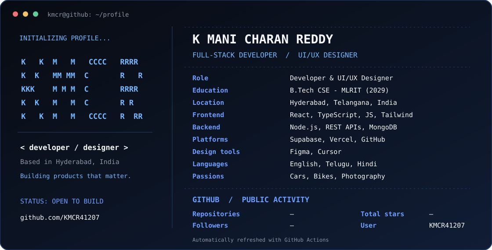
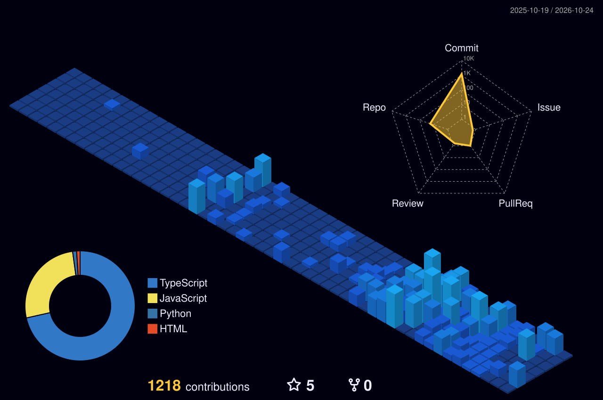

# K Mani Charan Reddy

**Full-Stack Developer · UI/UX Designer · Builder**

*Building thoughtful digital experiences, from AI-powered tools to logistics platforms.*

<!-- Generated by scripts/generate_terminal.py; automatically refreshed by GitHub Actions. -->

  

## About me

I'm a Computer Science Engineering undergraduate at **MLR Institute of Technology (2029)**, based in Hyderabad, India. I enjoy creating responsive web applications, designing memorable UI/UX, and translating ideas into real products. Outside of coding, I'm into motorsports, photography, and videography.

- **Frontend:** React, TypeScript, JavaScript, Tailwind CSS, HTML, CSS
- **Backend & Data:** Node.js, REST APIs, MongoDB, Supabase
- **Design & Tools:** Figma, GitHub, Vercel, Cursor
- **Interests:** Web development, UI/UX, cars, bikes, photography, videography

## Featured projects

| Project | What it does |
| --- | --- |
| [FarCar Fix](https://github.com/KMCR41207/FarCarFix) | AI-powered roadside help, image-based diagnostics, DIY steps, and mechanic discovery |
| [FleetFlow / Logistix](https://github.com/KMCR41207/LOGISTIX) | Freight, fleet, and delivery operations platform |
| [Livaani / LIVN](https://github.com/KMCR41207/LIVN) | Premium ethnic fashion e-commerce and bespoke shopping experience |
| [Stackweb](https://github.com/KMCR41207/StackWeb) | Custom web development and design startup |
| [ASR Infra](https://github.com/KMCR41207/ASR-INFRA) | Logistics and construction-material services platform |

## 3D contribution calendar

  

## Contribution snake

  

[Explore my repositories](https://github.com/KMCR41207?tab=repositories) · [Follow on GitHub](https://github.com/KMCR41207)

